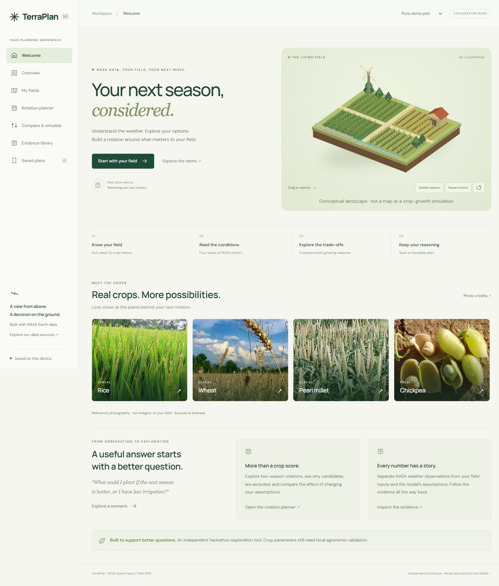

# TerraPlan

**Explore your next crop rotation with NASA weather history and reasoning you can inspect.**

[](https://github.com/playxgaming/terraplan-fieldshift/actions/workflows/ci.yml)
[](LICENSE)

A NASA Space Apps **Field Shift** hackathon prototype. TerraPlan combines a field profile, four years of NASA POWER weather and explicit model assumptions to compare two-season crop rotations.

**[Live demo](https://terraplan-fieldshift.sarveshsehra1.chatgpt.site/)** · **[Model & assumptions](docs/MODEL.md)** · **[Architecture](docs/ARCHITECTURE.md)** · **[Independent AI review handoff](docs/AI-REVIEW-HANDOFF.md)**

The live demo is owner-private and may require its owner's ChatGPT account. Anyone with this repository can run the full app locally without that account or an API key.



## What you can do

- Create multiple field profiles with coordinates, soil, hectares, previous crop and irrigation.
- Inspect observed rainfall and temperature across four historical crop years.
- Compare both seasons of predefined rotations, including reasons for excluded candidates.
- Test rainfall, heat and irrigation scenarios independently for each season.
- Compare up to three rotations and inspect their scores across historical years.
- Save a plan with its original inputs and source data; import/export JSON, compare snapshots and print reports.
- Explore an interactive WebGL farm and real crop-reference photos with author/license credits.

## Quick start

**Requirements:** Node.js 22 or newer; Node.js 24 is used in CI. No application dependencies need to be installed.

```bash
git clone https://github.com/playxgaming/terraplan-fieldshift.git
cd terraplan-fieldshift
npm start
```

Open **http://127.0.0.1:3000**. To choose another port:

```bash
npm start -- --port 8080
```

Python is an alternative if you only want to preview the static app:

```bash
python -m http.server 8080 --bind 127.0.0.1 --directory dist
```

Use an HTTP server, rather than opening `index.html` directly. The saved Pune demo works without internet when served locally. Custom-location NASA requests require internet. Web fonts fall back to system fonts.

## Try the demo

1. Choose **Explore the demo** on Welcome.
2. Open **Rotation planner** and inspect the two growing windows and candidate explanations.
3. Open **Compare & simulate**, then try **Hotter + drier**.
4. Review the difference between observed baseline and adjusted scenario.
5. Save the plan and export its JSON from **Saved plans**.
6. Open **Evidence library** to inspect NASA metadata and all scoring assumptions.

## Verification

```bash
npm run check      # Syntax, assets, attribution records and local documentation links
npm test           # Eight domain/storage/data tests + two local HTTP preview tests
npm run verify     # Both checks and tests
```

The CI workflow runs these checks on pushes and pull requests. The model tests use the bundled data and do not call NASA. HTTP tests bind an ephemeral loopback port; they do not call external services. See [testing](docs/TESTING.md) for coverage and remaining verification gaps.

## Scientific boundary

TerraPlan is an **exploration tool, not locally validated farming advice**. It uses fixed four-month windows, broad reference crop-water demands, illustrative heat/calendar/soil assumptions and a simple weighted score.

It does not predict yield, profit or future weather. It does not measure irrigation savings or soil improvement. A high score is not a probability of crop success. The 3D scene is illustrative, not a map of the selected field or a crop-growth simulation.

Regional agronomic review and farmer usability studies remain pending. [Read the complete model](docs/MODEL.md) before interpreting the results.

## Data and assets

- **NASA POWER:** daily precipitation, mean temperature and maximum temperature for June 2021–May 2025. The bundled reference point is Pune, India (18.52°N, 73.86°E). The raw response, exact request, time standard and retrieval timestamp are preserved.
- **Field inputs:** entered manually; NASA weather is regional gridded data, not a field sensor.
- **Crop parameters:** cereal demand constants use midpoints of broad FAO ranges; many remaining parameters are illustrative.
- **Photographs:** seven real crop-reference images, with individual licenses and credits.

See [data provenance](docs/DATA.md) and [third-party notices](THIRD_PARTY_NOTICES.md). The original code's MIT license does not relicense these third-party assets.

## Repository layout

```text
dist/                 Tracked buildless application source and static assets
  app.mjs             Navigation, state and user workflows
  views.mjs           Pages, forms, charts and reports
  engine.mjs          Crop definitions, screening and scoring
  data.mjs            NASA adapter and stale-response protection
  storage.mjs         Device storage and saved-plan validation
  field3d.mjs         WebGL diorama and animation controls
  photos.mjs          Crop photos, details and credits
  assets/             Crop photographs and attribution metadata
  data/               Bundled public NASA records
scripts/              Dependency-free local preview and repository checks
test.mjs              Domain, persistence and data-client tests
docs/                 Architecture, science, testing, roadmap and review handoff
.github/              CI, issue forms and pull-request template
```

`dist/` is the source here, not an ignored generated build. There is no compilation step or frontend framework dependency. Private Sites configuration and credentials are deliberately excluded from this GitHub distribution. See [deployment](docs/DEPLOYMENT.md) for the hosting boundary.

## Storage and privacy

Field profiles, drafts and saved plans live in this browser's `localStorage`. There is no application backend, account database or cloud sync. Export important plans to keep a backup. Opening a custom field requests NASA data using its coordinates. Crop photos are bundled; Google Fonts is an optional external request. See [security policy](SECURITY.md).

## Contributing and next steps

Start with [contributing](CONTRIBUTING.md) and the [roadmap](docs/ROADMAP.md). The [full AI review handoff](docs/AI-REVIEW-HANDOFF.md) records known limits and concrete audit targets; it describes the source snapshot before this repository packaging work.

For the release history, see [CHANGELOG.md](CHANGELOG.md). Please keep future improvements evidence-based: separate software checks from agronomic validation and do not invent measured benefits.

## License and credits

Original software and original documentation: [MIT](LICENSE), except third-party material identified in [THIRD_PARTY_NOTICES.md](THIRD_PARTY_NOTICES.md). Crop photographs retain their source licenses. NASA/provider data retain applicable source terms. NASA names and logos are not licensed by this repository.

Independent hackathon prototype. Not affiliated with or endorsed by NASA.
