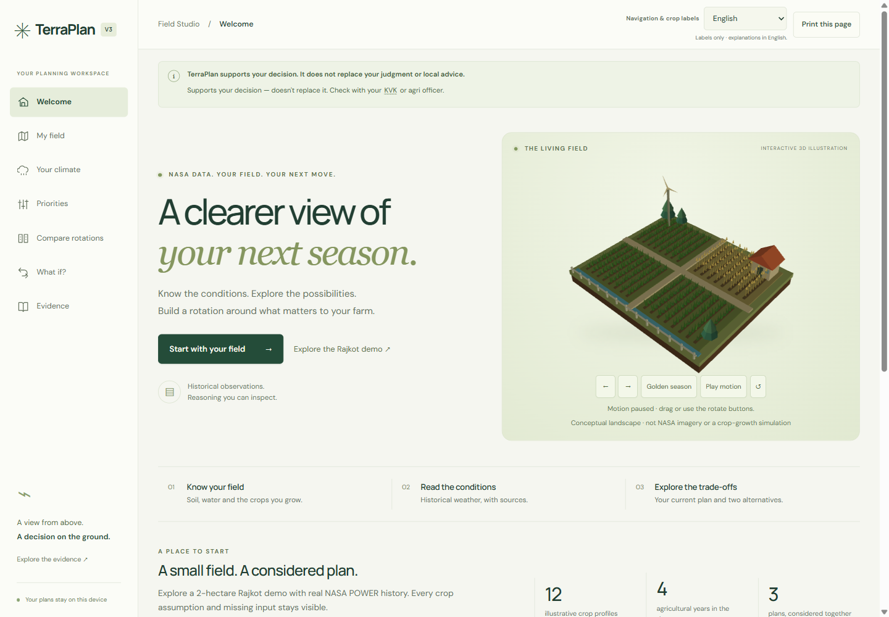
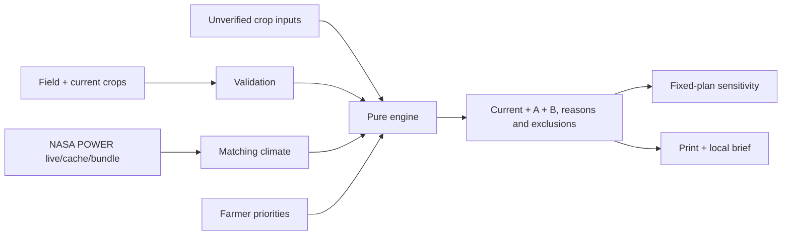

<div align="center">

# ✳ TerraPlan · Field Studio
### NASA history. Farmer priorities. Decisions you can inspect.

**AEGIS LABS · NASA Space Apps 2026 · Field Shift**

[](https://github.com/playxgaming/terraplan-fieldshift/actions/workflows/ci.yml)
[](https://github.com/playxgaming/terraplan-fieldshift/actions/workflows/pages.yml)
[](LICENSE)


**[Open planner](https://playxgaming.github.io/terraplan-fieldshift/) · [Interactive project guide](https://playxgaming.github.io/terraplan-fieldshift/project.html) · [Seven-slide presentation](https://playxgaming.github.io/terraplan-fieldshift/pitch.html)**

[](https://playxgaming.github.io/terraplan-fieldshift/project.html)

*Earlier Studio design screenshot. The live guide contains the current fifteen-crop release.*
</div>

TerraPlan compares the **current crop rotation and two alternatives** using historical NASA POWER data, soil category, irrigation, equipment and six farmer priorities. It exposes reasons, evidence, potential benefits, information gaps and local checks for every plan.

> TerraPlan supports your decision. It does not replace your judgment or local advice.

GitHub's README cannot execute JavaScript. The linked **interactive project guide** supplies the website experience: moving 3D field, searchable crop explorer, season filters, source notes, architecture explorer and demonstration walkthrough.

## Explore the working project

| Feature | Behavior |
|---|---|
| Jaipur demo | One click loads a hypothetical 2 ha farm near Jobner using bundled real NASA history |
| Field entry | Validated location, soil, water, equipment and actual crops; Bare supported; save and restore locally |
| Crop catalogue | 15 unverified profiles, including source-researched Indian mustard, barley and cluster bean |
| Comparison | Current / A / B with five explanations, crop photos, timelines, water gaps and explicit exclusions |
| Priorities | Six sliders, live ranking and independent browser persistence |
| What-if | Rain, temperature and irrigation sensitivity on fixed plans across four historical crop years |
| Evidence | NASA request URLs, dates, resolutions, formulas, crop references and missing-data notes |
| Sharing | Printable screens, local JSON decision brief and seven presentation slides |
| Visual experience | Original WebGL farm, motion controls, static fallback, licensed local photos and fonts |
| Optional tools | Opt-in map; Hindi/Gujarati/Marathi navigation and crop labels; explanations remain English |

## Try the Jaipur demo

1. Choose **Run the Jaipur demo**. It replaces the unsaved draft while preserving your saved field, priorities and What-if settings.
2. Inspect current / A / B, open a timeline month and review water gaps.
3. Adjust priorities and experiment with a drier or warmer historical scenario.
4. Open Evidence; download a brief from Compare → Data, priorities & decision brief.

The point is **26.97 N, 75.38 E**, near Jobner. The bajra → wheat → Bare scenario uses broad Loam soil, a well and 150 mm winter irrigation. These are assumptions, not a surveyed farm or measured well capacity.

| Plan, all priority weights 3 | Relative score | Modelled winter water gap |
|---|---:|---:|
| Current: bajra → wheat → Bare | 50.59 | 235.36 mm |
| A: fodder sorghum → chickpea → Bare | 71.41 | 93.60 mm |
| B: maize → chickpea → Bare | 70.23 | 93.60 mm |

This fixture has **141 retained rotations, 57 exclusions, 130 scored alternatives and 10 unavailable totals**. Counts are not evidence of agronomic success. Adding crops changes water-priority normalization; scores across catalogue versions are not measured improvements. Passing the illustrative water-gap rule can still leave a shortfall.

## Data and scientific boundaries

NASA POWER daily history: **June 2022–May 2026**. Monthly history: **1991–2024**. Baseline crop year: June 2025–May 2026. Live responses, validated caches and matching local bundles have separate source labels. Missing observations stay missing. POWER soil wetness is model-derived, not a direct SMAP or field measurement.

The original twelve crop rows are AI-drafted illustrative inputs. The three additions have a **literature review** with government, ICAR and FAO references. Every crop remains `verified: false`. Published context is separated from assumed water proxies, thresholds, calendar bins and 0–10 scores. See [crop review](docs/jaipur/crop-review.md).

SMAP, IMERG and GRACE observations are **not supplied**; their cards show Not loaded yet. No measured soil report, local price feed, field trial, yield/profit prediction or institutional endorsement is claimed. The 3D landscape and photos are representative. US-only datasets are not presented as Jaipur evidence.

## Run locally

Python 3 serves the static app; Node 22+ runs checks (CI uses Node 24). No build step or npm runtime dependencies.

```sh
git clone https://github.com/playxgaming/terraplan-fieldshift.git
cd terraplan-fieldshift
git checkout codex/terraplan-v3-studio
python -m http.server 8080 --bind 127.0.0.1
```

Open **http://127.0.0.1:8080/**, **/project.html** or **/pitch.html**. Use `python3` where needed. Serve over HTTP; do not open module files directly.

```sh
npm ci --ignore-scripts --no-audit --no-fund
npm run verify
```

**110 tests** cover input/storage boundaries, crop/source validation, pure calendars and scores, missing weather, provenance/cache fallback, fixed-plan sensitivity, export, gallery filters, labels and public packaging. Browser checks complement the suite; certification across every device or screen reader is not claimed.

Refresh weather with `node scripts/fetch-demo.mjs --year 2025`. It needs internet and validates both responses before replacement. No API key is required. The bundled demo runs without internet from a local server; there is no service worker or guarantee that an uncached remote shell opens offline. Live weather and the optional map need internet.

## Architecture



| Area | Files |
|---|---|
| Planner and UI | `index.html`, `app.mjs`, `views.mjs`, `style.css`, `studio.css` |
| Pure calculations | `engine.mjs` |
| Field/preferences | `field.mjs`, `priorities.mjs`, `scenario.mjs`, `labels.mjs` |
| NASA data | `data.mjs`, `data/demo-power-*.json` |
| Crop inputs | `data/crops.json` |
| 3D and photographs | `field-scene.mjs`, `photos.mjs`, `assets/` |
| Interactive guide | `project.html`, `project.css`, `project.mjs` |
| Release packaging | `scripts/package-site.mjs`, `.github/workflows/pages.yml` |

No application backend, account database or payment flow exists. Field, priority, label, weather and What-if records use separate validated browser keys. Export contains coordinates; share intentionally. Explicit NASA loading and the optional map send location-dependent requests.

## Deployment and contribution

Active release branch: **`codex/terraplan-v3-studio`**. GitHub Pages publishes that branch after verification. V2 `main` and the earlier V3 branch are preserved. The separate [Studio mirror](https://terraplan-v3-studio.sarveshsehra1.chatgpt.site/) uses the same allowlisted static output. Different origins have separate browser storage.

`npm run package:site` creates a fresh `.pages-dist` and refuses to overwrite an existing directory. Only allowlisted runtime files, assets, demo data and licence are published. Git history, credentials, test files and local tooling are excluded. `build-info.json` records the canonical source version and commit.

Read [CONTRIBUTING.md](CONTRIBUTING.md), [SECURITY.md](SECURITY.md) and [CHANGELOG.md](CHANGELOG.md). Bug/feature forms and a PR template are included. Crop changes require sources, units, regional scope, assumptions and local validation boundaries.

## Judging resources

- [Demo script](docs/jaipur/demo-guide.md)
- [Requirement checklist](docs/jaipur/requirements.md)
- [Submission draft](docs/jaipur/submission-draft.md)
- [Crop review](docs/jaipur/crop-review.md)
- [Seven-slide presentation](https://playxgaming.github.io/terraplan-fieldshift/pitch.html) — Print → Save as PDF
- [Original specification](AGENTS.md), preserved verbatim; later requests override location and crop scope

These materials do not register or submit the project. The team owner completes official participation and project submission.

## Team, credits and licence

**AEGIS LABS:** Sarvesh Sehra (owner), Ayush Tyagi, Aditya Rathi and Arshi.

NASA POWER: NASA Langley Research Center. Planned satellite evidence: SMAP, GPM IMERG, GRACE/GRACE-FO. Individual [photo credits](assets/photo-credits.json) retain their source/licence. Local fonts retain OFL licences. Optional map: Leaflet 1.9.4, BSD-2-Clause; © OpenStreetMap contributors.

Built with OpenAI Codex assistance for coding, research and testing. Crop assumptions remain unverified. Original software: [MIT](LICENSE). Third-party photos, fonts and provider data retain their own terms. Independent project; no NASA or university endorsement.
