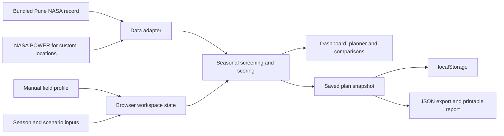

# Architecture

TerraPlan is a static single-page application using native JavaScript modules, browser APIs, SVG and custom WebGL. There is no application server, trained AI model, frontend framework or required third-party package.

## Data flow

## Modules

| File | Responsibility |
| --- | --- |
| `dist/app.mjs` | Hash routes, event handlers, state, dialogs and workflows |
| `dist/views.mjs` | HTML templates, charts, forms, report and comparison views |
| `dist/engine.mjs` | Pure validation, windows, exclusions, score and sensitivity functions |
| `dist/data.mjs` | NASA URL, saved record selection, memory cache, cancellation and generation checks |
| `dist/storage.mjs` | Workspace restoration, snapshot copies, schema checks and recalculation |
| `dist/field3d.mjs` | Illustrative WebGL geometry, controls, lifecycle and fallback |
| `dist/photos.mjs` | Crop-reference photo templates, alt text and credits |
| `scripts/serve.mjs` | Development-only loopback HTTP server |

## Routes

Main routes: `#home`, `#dashboard`, `#fields`, `#planner`, `#compare`, `#evidence`, `#plans`. Individual plans use `#plan/<id>`; `#snapshots` compares two saved snapshots.

The active field is shared across views. Draft settings are stored per field. Full view rendering and some DOM replacement are used; there is no virtual DOM or dedicated state-management library.

## Persistence and versioning

`localStorage` key: `terraplan.workspace.v2`. Plans contain copied field/settings, a raw data record, calculated result, creation time, schema `2` and model `2.0.0`. Creation uses deep copies. Restore/import validates and recalculates results under the supported model code, so these are independent input/data snapshots rather than cryptographically immutable records.

Raw weather is duplicated in snapshots. Browser quota, corrupted state and older-model migrations remain important review areas. Normal creation/import limits are 20 fields/plans; restore currently accepts collections up to 100. This discrepancy is documented, not silently corrected during GitHub packaging.

## 3D and photographs

The farm illustration is independent of scoring and field geometry. It pauses offscreen/hidden, respects reduced-motion preference, and has a static SVG fallback. Photos are bundled reference images with individual licenses. The 3D scene is not a measured map, crop-growth simulation or scientific data layer.

## Distribution boundary

`dist/` contains tracked application source and static files. The GitHub repository is a clean distribution and does not contain the private Sites source history or hosting manifest. Repository packaging does not update the existing live Site automatically.
